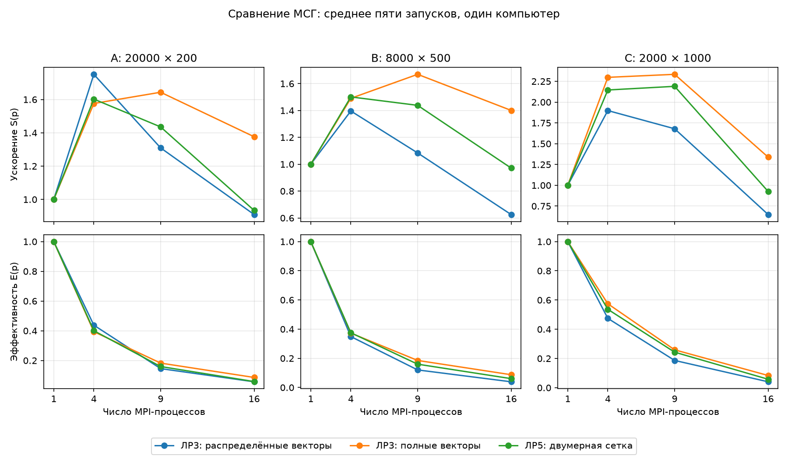

# Лабораторная работа №5
## Группы процессов и коммуникаторы. Двумерная декомпозиция матрицы

Исмаилов Самир Рамазан Оглы ПИН-м-о-26-1

## 1. Цель и состав работы

Реализовать умножение матрицы на вектор на квадратной сетке MPI-процессов, использовать новые операции в методе сопряжённых градиентов (МСГ) и сравнить его с двумя версиями ЛР3.

Выполнены двумерные операции `A @ x` и `A.T @ y`, МСГ для нормальных уравнений и локальное сравнение трёх реализаций. **Доступа к кластеру нет.** Использованы уменьшенные наборы ЛР4. Исходные кластерные наборы не измерялись, поэтому экспериментальная часть для них остаётся невыполненной.

## 2. Сетка и распределение данных

Пусть матрица `A` имеет размер `M × N`, а число процессов `p = q²`. Координаты процесса: `i = rank // q`, `j = rank % q`.

```text
Сетка 2 × 2 (p = 4):
            столбец 0       столбец 1
строка 0    rank 0: A00     rank 1: A01   ← части x и p
строка 1    rank 2: A10     rank 3: A11
               ↑
           части b и Ax
```

`comm.Split(i, rank)` создаёт коммуникатор строки, `comm.Split(j, rank)` — столбца. Благодаря `key=rank` локальный ранг в строке равен `j`, в столбце — `i`. Проверяется, что число процессов является полным квадратом; например, запуск на двух процессах завершается сообщением об ошибке.

Для каждого измерения вычисляются `counts` и `displs`: длина делится на `q`, остаток распределяется по первым блокам. Например, при `M=7, N=5, q=2` строки делятся как `[4,3]`, столбцы — `[3,2]`. Получаются блоки `4×3`, `4×2`, `3×3`, `3×2`. Если измерение меньше `q`, допустимы блоки нулевой длины.

Размеры столбцов передаются через `Scatter` в первой строке и `Bcast` вниз по столбцам. Размеры строк аналогично передаются по первому столбцу и затем вдоль строк.

Матрицу читает процесс 0. Для каждой строки сетки создаётся временная группа через `Range_incl`, содержащая процесс 0 и процессы этой строки; затем все процессы вызывают `comm.Create`. На корне прямоугольные блоки упаковываются в непрерывный буфер и передаются через `Scatterv`. Если процесс 0 не входит в выбранную строку сетки, он получает пустой блок. Временные коммуникаторы и группы освобождаются через `Free`, а постоянные — после решения.

Такой способ требует упаковки: прямоугольный блок столбцов в обычной построчной матрице обычно не является непрерывным участком памяти. Лекция со страницами 66–69 отдельно не приложена; реализована описанная в задании схема с временными группами и коммуникаторами.

## 3. Матричные операции и МСГ

Для `A @ x` вектор длины `N` распределяется через `Scatterv` по первой строке сетки. Каждый столбец получает свою часть через `Bcast`. Процесс вычисляет `Aij @ xj`; внутри строки частичные результаты суммируются через `Reduce(MPI.SUM)` на первом столбце. Итоговый вектор собирается через `Gatherv` только на процессе 0, когда нужен ответ всей задачи.

Для `A.T @ y` направление обменов меняется: части `y` с первого столбца передаются вдоль строк, а частичные вклады `Aij.T @ yi` суммируются по столбцам. Результат остаётся распределённым в первой строке.

Как в ЛР3, решается задача:

$$ (A^T A + \alpha I)x = A^T b. $$

Матрица `A.T @ A` явно не формируется. Начальное приближение `x=0`, начальная невязка `r=A.T @ b`, направление `p=r`. Одна итерация:

$$q=A^T(Ap)+\alpha p,\quad t=\frac{(r,r)}{(p,q)},$$
$$x\leftarrow x+tp,\quad r_{new}=r-tq,\quad
p\leftarrow r_{new}+\frac{(r_{new},r_{new})}{(r,r)}p.$$

Части `x`, `r`, `p`, `q` хранятся и обновляются только в первой строке. Части `b` и `Ap` находятся в первом столбце. Скалярные произведения считаются через `comm_row.Allreduce` только в первой строке; полученный скаляр передаётся вниз по столбцам. Функция `conjugate_gradient_method` принимает оба коммуникатора.

В новом решателе нет `Allgatherv`: полный рабочий вектор не собирается на всех процессах. Внутри итераций передаются блоки длины примерно `N/q` или `M/q` и отдельные скаляры. Полный ответ собирается один раз после завершения цикла. Исходная матрица всё ещё хранится на корне для начального распределения — ограничение памяти корня этим не устранено.

Остановка: `||r|| ≤ max(1e-12, 1e-10 ||r0||)`. По умолчанию предел — `4N` итераций. Предусмотрена регуляризация `alpha ≥ 0`; неположительная кривизна или недостижение допуска не выдаются за успешную сходимость. Для плохо обусловленных задач работа с нормальными уравнениями ухудшает обусловленность; двумерное распределение само по себе эту проблему не решает.

## 4. Запуск и проверка

Нужны Python, MPI и зависимости из `requirements.txt`. Команды выполняются из корня проекта:

```bash
python -m pip install -r requirements.txt
mpiexec -n 4 python main.py matvec
mpiexec -n 4 python main.py cg
mpiexec -n 9 python main.py cg --alpha 0.001
```

В `data/sample/` приложена система `7×5`. **В этой работе `in.dat` содержит M, затем N**, как указано в ЛР5. Это отличается от формата ЛР3. `AData.dat` содержит матрицу, `xData.dat` — вектор длины `N`, `bData.dat` — правую часть длины `M`. Полученные ответы записываются в `Results_matvec.dat` и `Results_cg.dat`.

Проверены сетки на 1, 4, 9, 16 процессах и размеры `1×1`, `2×3`, `7×5`, `5×9`, `13×7`. Проверка охватывала соответствие блоков исходной матрице, локальные ранги, обе матричные операции, регуляризованный МСГ и нулевую правую часть. Сравнение выполнено с NumPy. Запуск на двух процессах корректно отклонён. Служебные проверки в сдаваемый проект не включены.

В основном эксперименте все три версии сошлись: A — 10 итераций, B — 17, C — 61. Максимальная относительная ошибка решения относительно известного `x` — около `3.63·10⁻¹⁰`. В CLI ответ дополнительно проверяется через `numpy.linalg.lstsq` либо прямое решение регуляризованной системы.

## 5. Сравнение производительности

Из ЛР4 взяты локальные наборы с теми же размерами, seed и алгоритмом генерации:

| Набор | M | N | Seed |
|---|---:|---:|---:|
| A | 20 000 | 200 | 101 |
| B | 8 000 | 500 | 102 |
| C | 2 000 | 1 000 | 103 |

Исходные кластерные размеры ЛР4: `20 000 000×200`, `8 000 000×500`, `2 000 000×1000`; только матрицы требуют 32, 32 и 16 ГБ соответственно. Эти наборы здесь не запускались.

Среда: один компьютер, Intel Core i5-12400F (6 ядер, 12 логических процессоров), Windows 11, Python 3.12.14, NumPy 2.3.5, mpi4py 4.1.2, Intel MPI 2021.18.1. Для NumPy установлены `OMP_NUM_THREADS=OPENBLAS_NUM_THREADS=MKL_NUM_THREADS=1`. **16 MPI-процессов превышают число логических процессоров**; это локальная перегрузка, а не запуск на 16 узлах.

Для каждой версии, набора и числа процессов: один прогрев и пять измерений. Показано арифметическое среднее максимального времени по рангам (`MPI.Wtime`). Измеряется только итерационный цикл, как в ЛР3: матричные операции, обмены, обновления и контроль остановки. Генерация, чтение, создание коммуникаторов, распределение матрицы, начальная невязка, сбор ответа и проверка исключены. Поэтому таблица не отражает полного времени выполнения программы.

Времена старых версий измерены заново на этих же данных. Ускорение каждой версии вычислено относительно её собственного запуска на одном процессе: `S(p)=T(1)/T(p)`, `E(p)=S(p)/p`. Для прямого сравнения разных версий нужны также абсолютные времена.

| Набор | Версия | p | Время, мс | S(p) | E(p), % |
|---|---|---:|---:|---:|---:|
| A | ЛР3 полная | 1 | 27.519 | 1.000 | 100.0 |
| A | ЛР3 упрощённая | 1 | 26.859 | 1.000 | 100.0 |
| A | ЛР5 2D | 1 | 28.043 | 1.000 | 100.0 |
| A | ЛР3 полная | 4 | 15.716 | 1.751 | 43.8 |
| A | ЛР3 упрощённая | 4 | 17.042 | 1.576 | 39.4 |
| A | ЛР5 2D | 4 | 17.502 | 1.602 | 40.1 |
| A | ЛР3 полная | 9 | 21.016 | 1.309 | 14.5 |
| A | ЛР3 упрощённая | 9 | 16.343 | 1.643 | 18.3 |
| A | ЛР5 2D | 9 | 19.537 | 1.435 | 15.9 |
| A | ЛР3 полная | 16 | 30.262 | 0.909 | 5.7 |
| A | ЛР3 упрощённая | 16 | 19.514 | 1.376 | 8.6 |
| A | ЛР5 2D | 16 | 30.022 | 0.934 | 5.8 |
| B | ЛР3 полная | 1 | 41.748 | 1.000 | 100.0 |
| B | ЛР3 упрощённая | 1 | 42.475 | 1.000 | 100.0 |
| B | ЛР5 2D | 1 | 42.349 | 1.000 | 100.0 |
| B | ЛР3 полная | 4 | 29.899 | 1.396 | 34.9 |
| B | ЛР3 упрощённая | 4 | 28.493 | 1.491 | 37.3 |
| B | ЛР5 2D | 4 | 28.212 | 1.501 | 37.5 |
| B | ЛР3 полная | 9 | 38.508 | 1.084 | 12.0 |
| B | ЛР3 упрощённая | 9 | 25.445 | 1.669 | 18.5 |
| B | ЛР5 2D | 9 | 29.441 | 1.438 | 16.0 |
| B | ЛР3 полная | 16 | 66.734 | 0.626 | 3.9 |
| B | ЛР3 упрощённая | 16 | 30.321 | 1.401 | 8.8 |
| B | ЛР5 2D | 16 | 43.588 | 0.972 | 6.1 |
| C | ЛР3 полная | 1 | 59.568 | 1.000 | 100.0 |
| C | ЛР3 упрощённая | 1 | 56.686 | 1.000 | 100.0 |
| C | ЛР5 2D | 1 | 60.678 | 1.000 | 100.0 |
| C | ЛР3 полная | 4 | 31.376 | 1.899 | 47.5 |
| C | ЛР3 упрощённая | 4 | 24.669 | 2.298 | 57.4 |
| C | ЛР5 2D | 4 | 28.277 | 2.146 | 53.6 |
| C | ЛР3 полная | 9 | 35.463 | 1.680 | 18.7 |
| C | ЛР3 упрощённая | 9 | 24.286 | 2.334 | 25.9 |
| C | ЛР5 2D | 9 | 27.710 | 2.190 | 24.3 |
| C | ЛР3 полная | 16 | 91.842 | 0.649 | 4.1 |
| C | ЛР3 упрощённая | 16 | 42.352 | 1.338 | 8.4 |
| C | ЛР5 2D | 16 | 65.517 | 0.926 | 5.8 |



[Средние времена и метрики CSV](report/results.csv), [все пять измерений, итерации и ошибки](report/raw.json).

В наборе A при `p=4` полная версия ЛР3 быстрее 2D: 15.716 против 17.502 мс. В B при `p=4` 2D немного быстрее: 28.212 против 28.493 мс у упрощённой версии; разница мала и не доказывает устойчивое преимущество. В C при `p=9` упрощённая версия быстрее 2D: 24.286 против 27.710 мс. При `p=16` времена растут, особенно у полной версии и 2D. В этих условиях нельзя утверждать, что двумерное разбиение всегда даёт выигрыш.

## 6. Обмены, ограничения и выбор декомпозиции

В одномерной полной версии ЛР3 вектор `p` длины `N` собирается на каждом ранге через `Allgatherv`, а для транспонированного умножения каждый ранг создаёт вклад длины `N`. В упрощённой версии полные векторы хранятся на каждом процессе и используется `Allreduce` длины `N`.

В 2D одна пара матричных операций использует рассылку и редукцию блоков `N/q` и `M/q`. Это снижает размер векторов на отдельном процессе, но добавляет обмены в двух направлениях и работу двух семейств коммуникаторов. Оценка размеров сообщений — `O((M+N)/sqrt(p))` на ранг за пару операций, без учёта алгоритма коллективных вызовов и латентности. Это не утверждение о точном общем сетевом трафике: он зависит от MPI и топологии. При распределении матрицы суммарно всё равно передаются все её элементы.

При `M` и `N` сопоставимого порядка и достаточно больших блоках 2D может быть выгодной: нет репликации полного рабочего вектора на каждом ранге. При `N << M` становятся дорогими обмены блоков длины `M/q`, которые одномерная схема сохраняет локальными. При `M << N` возникает противоположная асимметрия; квадратная сетка также плохо соответствует форме матрицы. Поэтому отношение сторон и размер блоков важнее самого факта двумерного разбиения.

Для локальных небольших наборов разумно выбирать версию по замерам, а не по теоретической оценке сообщений. Здесь лучшая версия зависит от набора и числа процессов. Для больших задач выбор следует повторно проверить на реальном кластере. Начальная упаковка и распределение с корня могут стать отдельным узким местом, хотя в приведённые времена не входят.

Возможные улучшения: прямоугольная сетка `Pr×Pc` с `Pr*Pc=p`, подбор её формы под `M/N`, чтение блоков самими процессами, производные MPI-типы вместо части упаковок, переиспользование буферов и перекрытие обменов с вычислениями. Например, выбор `Pr/Pc` порядка `M/N` уменьшает дисбаланс геометрии блоков; это ориентир, который требует проверки производительности. Для нового варианта потребуются соответствующие изменения логики групп и разбиения.

## 7. Ответы на контрольные вопросы

1. **Преимущество 2D.** Рабочие векторы распределены по границе сетки; размер блока обмена уменьшается до `N/q` или `M/q`. Выигрыш зависит от формы задачи и расходов MPI.
2. **Split, color, key.** `color` выбирает подгруппу, `key` задаёт порядок рангов внутри неё. Разные цвета создают разные коммуникаторы.
3. **Полный квадрат.** Нужен именно для принятой сетки `q×q`. MPI в целом допускает прямоугольные сетки с произвольным числом процессов.
4. **Временные коммуникаторы.** Корень и очередная строка сетки объединяются через `Range_incl` и `Create`, получают упакованные блоки через `Scatterv`; объекты затем освобождаются. Сложность — согласовать порядок участников, размеры и смещения буферов.
5. **Редукция результата.** Блоки одной строки матрицы дают вклады в одни и те же компоненты `Ax`; они складываются вдоль строки. Готовые разные части собираются в первом столбце.
6. **Отказ от полных векторов.** Вместо `Allgatherv` блоки распространяются через `Bcast` по столбцам или строкам, результаты редуцируются в обратном направлении.
7. **Размещение векторов.** `x`, `p`, `r` и `q` — первая строка; `b` и `Ax` — первый столбец. Временные копии блоков участвуют в локальных умножениях.
8. **Подходящие размеры.** Достаточно большие блоки и умеренное отношение сторон. Для сильно вытянутых матриц стоит сравнить одномерную и прямоугольную двумерную схемы.
9. **Накладные расходы.** Создание коммуникаторов, упаковка матрицы, два направления обменов, редукции скаляров и синхронизация. При маленьких блоках расходы могут превысить выигрыш.
10. **Оптимизация.** Подбор формы сетки, распределённый ввод, повторное использование памяти, неблокирующие обмены и измерения на целевой системе.

## 8. Воспроизведение и вывод

```bash
python scripts/benchmark.py
```

`mpiexec` должен находиться в `PATH`; при необходимости путь задаётся переменной `MPIEXEC`. Скрипт создаёт наборы из `data/local.json` в `data/generated/` и повторяет сравнение. Большие сгенерированные файлы в архив не включены. Перед запуском генератора следует ограничить три переменные потоков NumPy значением `1`; для дочерних MPI-процессов скрипт задаёт их сам. Повторный запуск обновляет результаты и график, после чего числа в тексте нужно сверить заново.

Реализованы двумерное умножение и МСГ без сборки полных рабочих векторов на каждом процессе. Результаты согласуются с NumPy и известным решением. Локальные измерения показали, что уменьшение размера сообщений не гарантирует ускорения: важны форма матрицы, размер блоков, число процессов и расходы коллективных операций. Кластерные выводы по этому эксперименту сделать нельзя.
